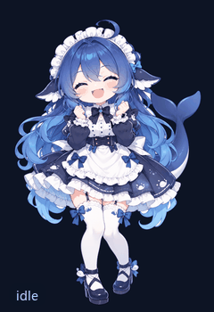

[English](README.md) | **简体中文**

# 蓝白鲸尾女仆 · DSH 桌宠

一只给 DeepSeek Harness [`@linxin666/dsh-pet`](https://github.com/zhu1090093659/dsh-pet) 插件用的动画自定义宠物。
由一张立绘生成：10 条轨道、153 帧，包含待机小动作、会话状态反应和点击反应。




## 这是什么

- 宠物 id：`whale-maid`
- 显示名：蓝白鲸尾女仆（Blue-White Whale-Tail Maid）
- 清单：`pet/pet.json`（manifest v2，`renderer: frames2d`）
- 10 条轨道、153 帧：496 × 724 透明 WebP
- 待机：`pet/idle/01..24.webp`，100 ms/帧，2.4 秒循环
- 环境动作：空闲导演每 18 秒掷一次骰，大约每 30 秒会出一个动作（摇尾 / 歪头 / 小跳）
- 会话状态：thinking / tool / review → `think`；done → `hop`；failed → `droop`
- 点击反应：头 / 身体 / 腿 → `pat-head` / `poke-body` / `shiver`
- 默认显示：210 px 高（可在 设置 → 宠物 调整）

## 操作

- 点 **头 / 身体 / 腿** 会播放对应反应，同时仍算摸头并增加心情值。
- 悬停宠物，打开 **玩法** 可以看心情条。
- 空闲导演每约 18 秒掷一次骰；连续两次没抽中动作后会强制演一个。
## 一键导入

要求：已安装 DSH Desktop（或 `dsh web`）并装有 `@linxin666/dsh-pet` 插件。
Windows 上用 Windows PowerShell 5.1 或 PowerShell 7+ 都可以。

```powershell
git clone https://github.com/hellokiaqi/whale-maid-dsh-pet.git
powershell -NoProfile -ExecutionPolicy Bypass -File .\whale-maid-dsh-pet\scripts\install.ps1
```

脚本会：

1. 自动找 `$env:DSH_HOME`，找不到再找 `%USERPROFILE%\.dsh-beta` / `%USERPROFILE%\.dsh`；
2. 把 `pet/` 复制到 `$DSH_HOME\pets\whale-maid\`；
3. 打印帧数、目标路径和下一步。

然后 **重启 DSH Desktop**（右键托盘图标 → 重启 DSH Desktop），在 **设置 → 宠物** 里选择「蓝白鲸尾女仆」。

想顺便把默认宠物改成它：

```powershell
cd whale-maid-dsh-pet
powershell -NoProfile -ExecutionPolicy Bypass -File .\scripts\install.ps1 -Select
```

`-Select` 只会改 `profiles\desktop\cordis.patch.yml` 里 `- id: pet` 这一段的 `petId`；如果找不到这一段，就跳过，仍然可以在设置里手动选。

macOS / Linux（DSH 的 home 一般是 `~/.dsh`）：

```bash
git clone https://github.com/hellokiaqi/whale-maid-dsh-pet.git
bash whale-maid-dsh-pet/scripts/install.sh
```

## 更新

```powershell
cd whale-maid-dsh-pet
git pull
powershell -NoProfile -ExecutionPolicy Bypass -File .\scripts\install.ps1
```

重启 DSH Desktop 即可。宠物 id 不变，之前的选择和亲密度都会保留。

## 手动导入

不跑脚本也可以，直接把仓库的 `pet/` 目录整个复制过去：

```
%DSH_HOME%\pets\whale-maid\
  pet.json
  idle\01..24.webp
  hop\01..11.webp
  tail-wag\  head-tilt\  bounce\  think\  droop\  pat-head\  poke-body\  shiver\
```

`pet/previews/` 只是给 README 和预览看的，插件不会把它当作动画帧；手动导入时可以不要。

## 目录结构

```
whale-maid-dsh-pet/
├── pet/                 # 宠物包本体（复制这一层到 $DSH_HOME/pets/whale-maid）
│   ├── pet.json
│   ├── idle/            # 24 帧待机
│   ├── hop/             # 11 帧完成小跳
│   ├── tail-wag/ ...    # 另外 8 条反应/环境轨道
│   └── previews/        # README / 预览用 GIF
├── source/
│   └── base.png         # 1022×1550 透明底图
├── tools/
│   └── animate.py       # 生成全部轨道 + pet.json（Python + Pillow + numpy）
├── scripts/
│   ├── install.ps1
│   ├── install.sh
│   └── verify.mjs       # 不依赖插件内部代码的清单/帧校验
├── docs/
│   └── ANIMATION.md     # 轨道、时长、相位和调参说明（中文）
├── .github/workflows/
│   └── verify.yml       # push 时跑一次校验
├── README.md            # English
├── README.zh-CN.md      # 简体中文
├── NOTICE.md            # 素材来源与授权（英文）
└── LICENSE              # 脚本/文档 MIT（素材不含）
```

## 兼容性

- 清单版本：`petManifestVersion: 2`
- 渲染器：`frames2d`
- 宠物版本：`1.2.0`（10 条轨道，153 帧）
- 在 `@linxin666/dsh-pet` 0.4.7 + DSH Desktop Beta 2.0.18 上验证
- 插件契约变化时：改 `pet/pet.json`，然后跑 `node scripts/verify.mjs`

## 自定义

- **换速度**：改 `pet/pet.json` 里对应轨道的 `frameMs`（16–5000 ms）。
- **换动作**：替换某条轨道的帧，保持文件名和数量，或改 `frames` 列表。
- **改待机小动作**：改 `pet/pet.json` 的 `gameplay.idleDirector`（`intervalMs`、`idleWeight`、`maxMiss`、权重 `acts`）。
- **改点击反应**：改 `gameplay.touch.zones`（纵向区域、`state` 轨道、`stateMs`、台词、心情效果）。
- **加状态**：在 `frames2d.phases` 里把 `waiting` / `thinking` / `review` / `done` / `failed` 映射到已有轨道。
- **改幅度/重新生成**：改 `tools/animate.py` 里的振幅、帧数、时长，然后：

```bash
python -m pip install pillow numpy
python tools/animate.py
node scripts/verify.mjs
```

`tools/animate.py` 会同时重写 `pet/pet.json` 和预览 GIF，是轨道表的唯一来源。

更多说明见 [docs/ANIMATION.md](docs/ANIMATION.md)。

## 授权

- 脚本、清单、文档：MIT（见 [LICENSE](LICENSE)）。
- 宠物图像（`pet/` 下的各轨道 WebP、`pet/previews`、`source/base.png`）：
  **仅限个人使用**（`pet/pet.json` 中 `"license": "personal-use"`）。见
  [NOTICE.md](NOTICE.md)（英文）和下方声明。

## 来源与同人声明

本宠物是**非官方同人作品**。图像是用 AI 图像工具、以仓库所有者提供的参考图生成的：
一张中文梗图 **《当各家 LLM 做道德题时》**，画面中有 Claude、GPT、Llama、DeepSeek
的拟人角色围坐一桌。图中标注为 **“DeepSeek”** 的蓝发鲸尾女仆，是本宠物的形象基础。

参考图**未包含**在本仓库中。其原作者与来源未知，可能本身也是 AI 生成或同人作品。
图中包含第三方角色与标识（Claude、GPT、Llama、DeepSeek），相关权利归各自权利人所有。

本项目与 DeepSeek、Anthropic、OpenAI、Meta 或其他权利人**无隶属、赞助或背书关系**。
宠物图像仅限**个人、非商业使用**；不授予再分发许可。如果你是权利人并认为本仓库侵权，
请提交 issue，相关内容会被移除。

AI 生成内容可能不受著作权保护，也可能受生成工具条款约束。公开或商业使用前，
请咨询专业律师。
